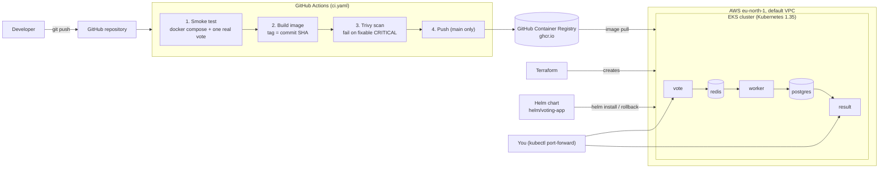

# Voting App: from code to automatic deployment (Capstone 1, "Ship It")

A DevOps capstone built on the [dockersamples/example-voting-app](https://github.com/dockersamples/example-voting-app).
The app is unchanged in behaviour; what this repository adds is everything needed to **ship it**:
hardened container images, a Kubernetes cluster created with Terraform, a CI pipeline in GitHub Actions
and a Helm chart with a rehearsed rollback.

> Author: _your name_ &nbsp;|&nbsp; Region: `eu-north-1` (Stockholm) &nbsp;|&nbsp; Cloud: AWS

## 1. What the app does

| Service | Role | Technology |
|---|---|---|
| `vote` | Web page where you cast a vote (cats or dogs) | Python / Flask |
| `redis` | Queue where a new vote waits | Redis |
| `worker` | Takes votes off the queue and saves them | .NET |
| `db` | Permanent storage of votes | PostgreSQL |
| `result` | Live results page | Node.js / Socket.IO |

Data flow: **vote → Redis → worker → PostgreSQL → result**.

## 2. Architecture



## 3. Repository layout

| Path | What it contains |
|---|---|
| `vote/`, `result/`, `worker/` | Application code and one hardened `Dockerfile` each |
| `docker-compose.yml` | Run the whole app locally |
| `terraform/` | Creates the EKS cluster in the default VPC |
| `helm/voting-app/` | The Helm chart and its single `values.yaml` |
| `.github/workflows/ci.yaml` | The pipeline: test, scan, build, push |

## 4. The five steps

### Step 1: Run it locally
```bash
docker compose up --build
# vote:   http://localhost:8080
# result: http://localhost:8081
```

### Step 2: Containerize it safely
Every image follows the same three rules:

- **Pinned base images.** Each `FROM` names a tag *and* a digest (`image:tag@sha256:...`), so a build today and a build next month use the same base.
- **Non-root.** `vote` and `worker` create user `10001`; `result` uses the `node` user (uid 1000). Nothing runs as root.
- **`.dockerignore`** in every service keeps `.git`, `.env`, build output and docs out of the image.

Base images are on supported versions (Node 24, .NET 10, Python 3.11). An earlier version of this project used Node 18 and .NET 7, which are past end of life: pinning a digest of an image that no longer gets patched only freezes its vulnerabilities, and the Trivy scan caught that (see section 6).

### Step 3: Create a Kubernetes cluster with Terraform
```bash
cd terraform
terraform init
terraform plan -out=tfplan      # read the plan before applying
terraform apply tfplan
aws eks update-kubeconfig --region eu-north-1 --name voting-capstone
kubectl get nodes
```
- Uses the community module `terraform-aws-modules/eks/aws` (`~> 21.0`) with AWS provider `~> 6.0`.
- Kubernetes **1.35**, chosen because it is in EKS *standard* support (extended support costs six times more per hour).
- One managed node (`m7i-flex.large`) in the **default VPC**, public subnets, no NAT gateway.
- **Destroy and recreate from code** was demonstrated: `terraform destroy` removes all 38 resources and `terraform apply` rebuilds them in about five minutes.

### Step 4: Automate with GitHub Actions
On every push to `main` (and on pull requests) `.github/workflows/ci.yaml` runs:

1. **Smoke test:** starts the whole app with Docker Compose, casts a real vote with `curl`, and waits until it appears in PostgreSQL. This proves vote → Redis → worker → Postgres end to end.
2. **Build** each image, tagged with the full **commit SHA**.
3. **Trivy scan:** the job fails on any fixable `CRITICAL` vulnerability.
4. **Push** to `ghcr.io/<owner>/voting-app-<service>:<sha>`, only for pushes to `main`.

### Step 5: Deploy and roll back with Helm
```bash
helm install voting helm/voting-app --set image.tag=<commit-sha> --wait --timeout 5m
kubectl port-forward svc/vote 8080:8080 &
kubectl port-forward svc/result 8081:8081 &
```
**Bad release on purpose, then rollback:**
```bash
helm upgrade voting helm/voting-app --set image.tag=thisdoesnotexist --wait --timeout 90s   # fails
kubectl get pods        # new pods: ImagePullBackOff, old pods still Running (no downtime)
helm history voting     # revision 2: failed
helm rollback voting 1 --wait
helm history voting     # revision 3: "Rollback to 1"
```
Kubernetes keeps the old pods alive until new ones are ready, so the failed release never took the app down.

## 5. Security notes

- **No secrets in Git.** The pipeline pushes with the short-lived `GITHUB_TOKEN`. AWS credentials live in `~/.aws/credentials` on the operator's machine. `.gitignore` excludes Terraform state and plan files.
- **Pipeline supply chain.** Third-party actions are pinned to full commit SHAs, not tags. The Trivy binary is pinned to a version its vendor lists as safe, following the March 2026 Trivy supply-chain incident. Jobs get read-only permissions; only the push job can write packages.
- **Pods** run as non-root, drop all Linux capabilities, forbid privilege escalation and use the runtime default seccomp profile.

## 6. Problems met along the way

| Problem | Cause | Fix |
|---|---|---|
| Trivy failed `result` and `worker` | Base images (Node 18, .NET 7) were past end of life; `proxy-addr` and `System.Drawing.Common` had fixable CRITICAL CVEs | Moved to Node 24 and .NET 10, updated the lock file, added a fixed `System.Drawing.Common` reference |
| EKS node group `CREATE_FAILED` | The AWS Free plan only allows some instance types; `t3.medium` was rejected | Used an allowed type (`m7i-flex.large`) |
| `iam:CreateOpenIDConnectProvider` denied | Account-level policy blocks creating an OIDC provider | Set `enable_irsa = false`; the cluster uses Pod Identity instead |
| Push of workflow files rejected | Personal access token lacked the `workflow` scope | Created a token with `repo` and `workflow` scopes |

## 7. Known limitations

- **Demo database credentials.** The app's own source code hardcodes `postgres`/`postgres` (`worker/Program.cs`, `result/server.js`), so they appear in `values.yaml`. They are for the demo only; moving them to a Kubernetes Secret would also need code changes.
- Redis and PostgreSQL use `emptyDir` storage: votes are lost if their pods restart.
- Services are `ClusterIP`; the app is viewed through `kubectl port-forward`. Setting `service.type=LoadBalancer` would create a public AWS load balancer (not used, to avoid cost).
- Base images for `redis` and `postgres` in the chart are tagged, not digest-pinned.

## 8. Cost and cleanup

A running cluster costs roughly $0.20 to $0.25 per hour (EKS control plane $0.10, one node, public IPv4 addresses). The environment is created for each working session and destroyed afterwards:

```bash
helm uninstall voting
cd terraform && terraform plan -destroy -out=destroy.tfplan && terraform apply destroy.tfplan
```

## 9. Credits

Application: [dockersamples/example-voting-app](https://github.com/dockersamples/example-voting-app) (Apache 2.0).
